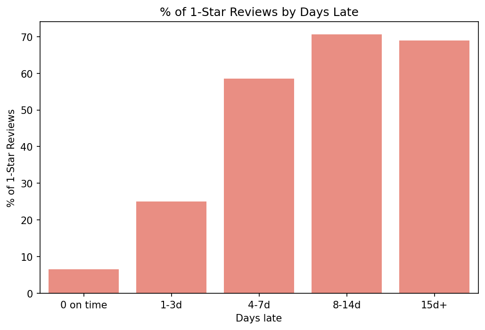

# Olist: how late is too late?

Olist shows customers a promised delivery date at checkout. I wanted to know
how far past that date an order can slip before it costs us the customer.

## What I found (96,470 delivered orders, Sep 2016 – Aug 2018)

- 6.8% of delivered orders arrived after the promised date.
- Late orders average 2.27 stars vs 4.29 on time. 54% of late orders get a
  1-star review, vs 6.6% on time.
- The damage is not linear. 1–3 days late: 3.29 stars. 4–7 days: 2.10.
  8+ days: about 1.7, with ~70% leaving 1 star.
- Cross-state orders (64% of volume) are late 8.1% of the time vs 4.5%
  within a state.
- Customers whose first order was late reordered 2.8% of the time vs 4.1%
  (first orders before Feb 2018, p ≈ 0.001). Small gap, but real.
- Late orders carry R$0.99M, about 7.5% of delivered sales.

Highest late rates by customer state: AL 21% (n=397, ±4pp), MA 17%, SE 15%,
PI 14%. These are associations, not proof that delay causes the low scores.

## Definitions
- Late: delivered on a later calendar day than promised (timestamps give 8.1%).
- Reviews: latest review per order; only reviewed orders in score stats.
- Sales: SUM(price), excludes freight; cancelled orders excluded.

## How to Run
1. Download the Olist dataset from Kaggle (https://www.kaggle.com/datasets/olistbr/brazilian-ecommerce) into the `raw/` folder.
2. Open `delivery_impact_analysis.ipynb` and run all cells.

